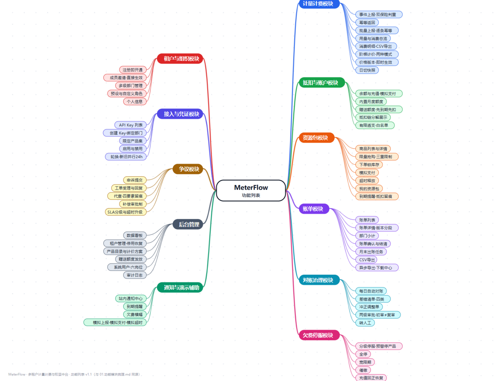
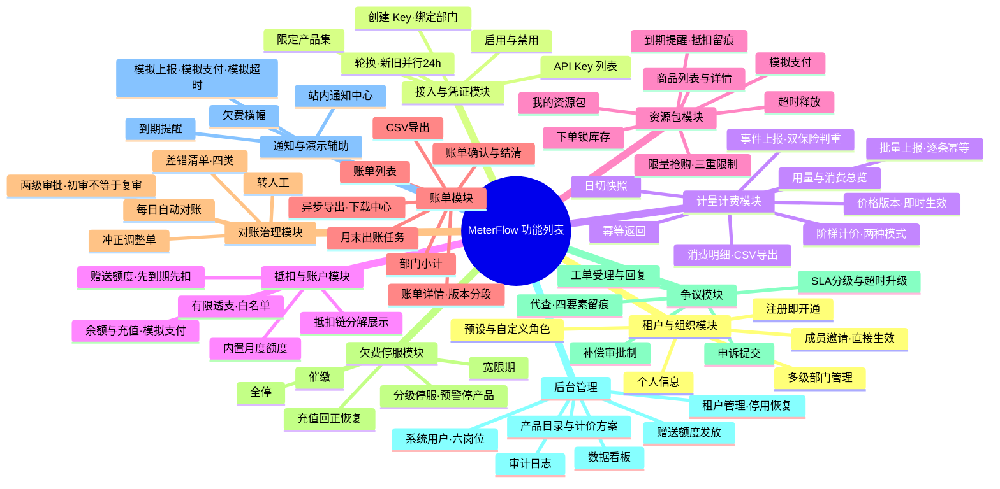

# MeterFlow 设计阶段 · 01 功能模块梳理

| | |
|---|---|
| 版本 | v1.0（已审核：第 6 章 17 项问题按建议全部裁决） |
| 日期 | 2026-11-03 |
| 阶段 | 设计阶段 · 第一阶段（需求与功能模块梳理） |
| 依据 | ① requirements.md v1.0（已评审通过，含 R1–R38 业务规则、第 6 章权限矩阵、第 7 章状态机、第 9 章默认约定表）；② prototype/ 交互原型（租户控制台 11 项 + 管理后台 11 项） |
| 范围边界 | 仅功能梳理、模块划分、流程与依赖关系；**不含**技术选型、数据库设计、API 设计、代码开发 |

**标注约定**：与需求文档一致的确认口径直接引用规则编号（R1–R38）；设计中新发现或需复核的问题编号为 **D-xx**，汇总于第 6 章，不擅自决定。

---

## 1. 项目主要功能全景

MeterFlow 的功能由**两个使用端 + 六个能力域**构成，全部来源于已评审通过的需求文档，无新增功能。

### 1.1 两端功能清单（与需求文档第 4/5 章一一对应）

**租户控制台（11 项）**：注册与开通、用量与消费总览、余额与充值（模拟支付）、资源包中心（抢购+我的资源包）、账单与消费明细、配额与欠费提示、API Key 管理、争议申诉、组织/成员/角色/部门、个人信息、通知中心。

**管理后台（11 项 + 1 项子功能）**：数据看板、租户管理、产品目录与计价方案（含价格版本）、资源包商品管理、订单管理、账单管理（日切/出账/催缴）、对账中心（对账/差错/调整单审批）、争议工单处理、免费额度与赠送管理、系统用户与角色、操作日志与审计。

### 1.2 六大能力域

| 能力域 | 覆盖功能 | 核心需求规则 |
|---|---|---|
| ① 接入域 | 租户注册开通、组织/成员/角色/部门、API Key 全生命周期 | 租户状态机、部门隔离口径、Key 轮换 |
| ② 计量计费域 | 事件上报与判重、阶梯计价、价格版本、抵扣优先级链、余额账户 | R1–R16、3.9 精度 |
| ③ 账务治理域 | 日切快照、月度出账、账单状态机、三方对账、差错冲正 | R17–R21、R26–R29 |
| ④ 权益营销域 | 资源包商品、限量抢购、实例生命周期、免费额度（内置+赠送） | R13–R15、R30–R34 |
| ⑤ 服务保障域 | 分级停服、催缴、争议工单（SLA/代查/补偿） | R22–R25、R35–R38 |
| ⑥ 平台支撑域 | 六岗位权限、审计留痕、站内通知、数据看板 | 6.2 权限矩阵、审计覆盖清单 |

### 1.3 演示辅助能力（非正式功能，声明）

原型中的「模拟一笔用量上报」「模拟支付」「模拟超时释放」「执行日切（模拟）」等为**原型演示辅助入口**，用于走查业务规则，不构成正式功能需求；正式设计文档中对应能力由真实业务系统触发（业务系统上报、支付网关、定时任务）。

### 1.4 功能列表总图（思维导图）

> 样式参照 NFTurbo 功能列表图；内容与第 2 章 13 个功能模块同源，仅按"端 + 能力域"重新组织，无新增功能。



*高分辨率版（2700×2050）：`assets/功能列表思维导图.png`；可编辑源（HTML+SVG，改数据即可重新生成）：`assets/mindmap.html`。*



---

## 2. 功能模块划分与职责

按业务域分 5 层共 **13 个模块**。控制台的"用量总览"页为跨模块数据展示（聚合 M5/M6/M9 数据），不独立设模块。

### 接入层

**M1 租户与组织管理**
- 职责：租户注册开通（注册即开通 + 内置免费额度自动发放）；租户状态管理（正常/预警/已停服/已停用）；多级部门树维护；成员管理（邀请/禁用/角色分配）；预设角色 + 自定义角色（权限点勾选）；**部门级数据隔离边界**（成员仅本部门、管理员全租户、未分配 Key 用量仅管理员可见）。
- 关联规则：R25（租户状态）、6.1 权限矩阵、部门隔离口径。
- 原型入口：`#/t/org`、`#/t/profile`、登录注册页；平台端 `#/a/tenants`。
- 上下游：为 M2/M3 提供租户与组织上下文；接受 M8 的状态联动。

**M2 接入凭证管理（API Key）**
- 职责：租户级多 Key（命名/备注/限定产品集）；启用/禁用；**轮换（新旧并行 24h）**；**可选绑定部门**（事件部门归属依据）；调用与上报时的 Key 状态校验。
- 关联规则：4.6 全部规则、R8（停服拒收时按产品+租户判定）。
- 原型入口：`#/t/keys`。
- 上下游：为 M3 提供事件归属（租户/部门）与合法性校验；依赖 M1 的部门树。

### 计费核心层

**M3 计量采集服务**
- 职责：事件接收与校验（Key/租户状态/停服产品拒收 R8）；**双保险判重**（上报系统+事件 ID；业务指纹兜底 R3）；幂等返回（R4）；**到达时间计费口径**（R5，日切快照定案不回溯）；超长迟到转人工差错队列（R6）；内部失败重试与差错队列（R7）；事件落明细（供 M6/M7 消费）。
- 关联规则：R1–R8。
- 原型入口：总览页「模拟用量上报」（演示辅助）。
- 上下游：上游 M2；下游 M4（送计价）、M7（迟到/失败转差错）、M6（日切数据源）。

**M4 计价引擎**
- 职责：产品目录/计量指标/计价项管理（平台侧）；阶梯定价两模式（账期内累计分段 / 档位单价，R10）；价格版本管理（**即时生效、账期内分段计费**，R11）；计价精度与舍入（3.9：分存储、逐笔 4 位小数、汇总 2 位、单价最小 0.0001 元）；内置免费额度定义（随计价方案）。
- 关联规则：R9–R12、3.9。
- 原型入口：`#/a/products`（含调价 → 新版本即时生效）。
- 上下游：上游 M3；下游 M5（计费结果送抵扣）。

**M5 抵扣与账户中心**
- 职责：**抵扣优先级链编排**（赠送额度→内置月度额度→资源包→余额，余量不足自动衔接，R13/R14）；免费额度生命周期（内置自然月重置不结转；赠送发放、先到期先扣）；资源包抵扣匹配（指定包按量纲、通用包按金额折算）；余额账户（有限透支、统一阈值+白名单、回正恢复 R16）；充值（模拟支付、即时到账、不退提）；**抵扣流水留痕**（R15）。
- 关联规则：R13–R16、R22 联动。
- 原型入口：`#/t/wallet`、模拟上报的抵扣链结果、`#/a/grants`（赠送发放）。
- 上下游：上游 M4；下游 M6（流水供出账）、M7（对账数据源）、M8（余额驱动停服判定）。

### 财务治理层

**M6 账单与账期**
- 职责：**每日日切**（零点锁定前一日快照，定案不回溯，R18）；**月度出账**（自然月账期，租户级一张账单 R17）；账单结构（产品×价格版本分段、部门小计、"原额+调整=应付"，R19）；账单状态机（已出账→已确认→已结清，叠加争议中/已调整标记）；CSV 导出；平台侧确认/结清操作。
- 关联规则：R17–R21。
- 原型入口：`#/t/bills`、`#/a/billing`（账单列表页签）。
- 上下游：上游 M3/M5；下游 M7（对账依据）、M10（争议关联对象）。

**M7 对账与差错处理**
- 职责：每日自动对账（计量vs计费、计费vs账户）+ 月末全量复核（R26）；差错分类（丢事件/重复计费/抵扣不符/账户不平，R27）；差错单管理；**调整单**（红字冲销/蓝字补记、关联原单、不改原始单据 R28）；**两级审批工作台**（审核员初审→财务复审，初审≠复审同岗 R29）；转人工挂起。
- 关联规则：R26–R29。
- 原型入口：`#/a/recon`（三个页签）。
- 上下游：上游 M3/M5/M6；生效调整单回写 M6 账单金额、M5 账户；依赖 M11 审批权限。

**M8 欠费与停服治理**
- 职责：**分级停服判定**（余额<0 → 预警：停用本月消费最高产品，不进催缴；余额≤透支阈值或宽限期 3 天满 → 全停+催缴，R22）；透支阈值管理（统一 -100 元 + 白名单，R24）；恢复（充值回正全部恢复，R23）；催缴（站内通知+横幅，记录留痕）；向 M3 输出停服拒收依据、向业务系统暴露停服错误码。
- 关联规则：R22–R25、R8。
- 原型入口：租户端全局横幅/通知；`#/a/billing` 欠费与催缴页签。
- 上下游：上游 M5（余额实时驱动）；联动 M1（租户状态）、M12（催缴通知）。

### 权益运营层

**M9 资源包与权益**
- 职责：商品管理（指定产品包=产品+指标+数量；通用包=金额面额；售价/有效期/库存/开售窗口）；**三重限制**（总库存+每人限购+单笔上限，R31）；**抢购时序**（下单锁库存→15 分钟未支付自动释放→支付发放实例，R32）；实例生命周期（有效→已耗尽/已过期，到期前 7/3/1 天提醒，不退订、到期清零 R33）；购买/抵扣/过期全程留痕（R34）。
- 关联规则：R30–R34。
- 原型入口：`#/t/packages`（大厅+我的资源包）、`#/a/goods`、`#/a/orders`。
- 上下游：实例供 M5 抵扣链消费；依赖 M12 到期提醒；订单数据供 M13 看板。

### 服务保障层

**M10 争议工单**
- 职责：租户申诉提交（关联账单/明细+理由）；工单状态机（待受理→处理中→已解决/已关闭）；**分级 SLA**（<1000 元 48h、≥1000 元 24h，超时升级提醒，R36）；客服**代查**（记录操作人/目标租户/查询范围/时间，R37）；**补偿审批制**（退费→调整单；送额度→赠送额度单；均走两级审批，客服不直赔，R38）。
- 关联规则：R35–R38。
- 原型入口：`#/t/disputes`、`#/a/disputes`。
- 上下游：补偿单走 M7 审批通道、回写 M5/M6；依赖 M11 留痕；联动 M12 通知。

### 平台支撑层

**M11 权限与审计**
- 职责：平台侧**六岗位**权限矩阵（管理员/运营/客服/审核员/财务/审计员，含两级审批的岗位约束）；租户侧权限点体系（与 M1 角色联动）；敏感操作强制留痕（代查/冲正/停服恢复/调价/额度与白名单调整 + 平台写操作 + 租户侧关键操作）；审计日志检索（保留 1 年，审计员只读）。
- 关联规则：6.2 矩阵、审计覆盖清单。
- 原型入口：`#/a/users`、`#/a/audit`、`#/t/org` 角色页签。
- 上下游：横切所有写操作模块；为 M7/M10 提供审批执行者约束。

**M12 通知与消息**
- 职责：站内通知（余额预警/停服、资源包到期 7/3/1 天、账单出账、争议进展、审核结果、赠送到账）；未读管理与全部已读；控制台全局横幅（欠费分级停服、部门隔离提示）。
- 关联规则：4.7、4.11；渠道仅站内（默认约定 #8）。
- 原型入口：`#/t/notifications`、各页横幅。
- 上下游：被 M6/M8/M9/M10 触发；接收方为租户角色。

**M13 数据看板**
- 职责：平台运营视图（充值收入、资源包销售、活跃租户、欠费/停服统计、用量趋势、对账差错率）；系统健康视图（日切/对账任务状态、差错积压、审批积压）。
- 关联规则：5.11。
- 原型入口：`#/a/dashboard`。
- 上下游：只读汇聚 M3–M9 数据，无下游。

---

## 3. 模块关系

### 3.1 依赖关系图（文字版）

```
                    ┌─────────────── 平台支撑层（横切） ───────────────┐
                    │  M11 权限与审计（审批岗位约束 · 敏感操作留痕）      │
                    │  M12 通知与消息（欠费/到期/出账/争议/审核结果）     │
                    │  M13 数据看板（只读汇聚）                          │
                    └──────────────────┬───────────────────────────┘
                                       │ 被 ①-⑨ 触发/约束
 M1 租户与组织 ──→ M2 接入凭证 ──→ M3 计量采集 ──→ M4 计价引擎
      │             （Key/部门归属）  （判重/拒收）      （阶梯/版本）
      │                                              │
      │（租户状态联动）                                ▼
      │                                      M5 抵扣与账户 ──────► M9 资源包与权益
      │                                        │    ▲                 （实例供抵扣）
      │                                        ▼    │（调整单回写）
      └──────────────► M8 欠费停服 ◄── 余额驱动 ┘    ├── M6 账单与账期 ◄── 日切/出账
                        │    │                      │        │
                停服拒收 │    │ 催缴通知              ▼        ▼
                        ▼    └────────► M12      M7 对账与差错 ── M10 争议工单
                    M3（拒收联动）                 （两级审批）     （补偿走 M7）
```

### 3.2 模块依赖矩阵

| 模块 | 依赖（上游） | 被依赖（下游） |
|---|---|---|
| M1 租户与组织 | — | M2/M3/M8/M11 |
| M2 接入凭证 | M1 | M3 |
| M3 计量采集 | M2、M8（停服依据） | M4、M6、M7 |
| M4 计价引擎 | M3、M1（租户×产品游标） | M5 |
| M5 抵扣与账户 | M4、M9（资源包实例）、M1（赠送发放） | M6、M7、M8 |
| M6 账单与账期 | M3、M5 | M7、M10、M12 |
| M7 对账差错 | M3、M5、M6、M11（审批） | M5/M6（回写）、M10（补偿通道） |
| M8 欠费停服 | M5（实时余额）、M1 | M3（拒收）、M12、M1（状态） |
| M9 资源包权益 | M1（租户/限购主体） | M5、M12（到期提醒）、M13 |
| M10 争议工单 | M6（账单）、M7（补偿审批）、M11（代查留痕） | M12 |
| M11 权限审计 | —（横切） | 全部写操作模块 |
| M12 通知 | M6/M8/M9/M10 | 租户端展示 |
| M13 数据看板 | M3–M9（只读） | — |

---

## 4. 核心业务流程（5 条主流程）

**F1 计量计费主链路**（M2→M3→M4→M5→M6→M12）
```
业务系统持 Key 调用 → 事件上报 → M3 校验（Key/租户状态/停服产品拒收 R8）
→ 双保险判重（R3，重复幂等返回 R4）→ M4 按到达时间+适用版本逐笔计价（R5/R10/R11）
→ M5 抵扣链核销（赠送→内置→资源包→余额，R13）→ 落明细+抵扣流水（R15）
→ M6 每日日切锁快照（R18）→ 月末出账（R17）→ M12 通知租户
异常分支：迟到>48h 或内部失败 → M7 差错队列转人工（R6/R7）
```

**F2 资源包抢购与生命周期**（M9→M5→M12）
```
M9 上架商品（三重限制 R31）→ 租户下单锁库存 → 待支付（15 分钟倒计时）
├─ 支付成功（模拟）→ 发放实例（有效期起算）→ 到期前 7/3/1 天提醒（M12）
│    → 实例进入 M5 抵扣链（指定包按量纲 / 通用包按金额折算）→ 余量递减留痕
└─ 超时未支付 → 库存自动释放 → 订单关闭（留痕）
实例终点：已耗尽 / 已到期清零（R33，全程留痕 R34）
```

**F3 对账与冲正**（M7→M11→回写 M5/M6）
```
日切后 M7 自动对账（计量vs计费、计费vs账户，R26）→ 差错识别（R27 分类）
→ 财务发起冲正 → 生成调整单（红冲/蓝补，关联原单）→ 审核员初审 → 财务复审（初审≠复审，R29）
→ 生效：回写账单应付（原额+调整=应付）/ 补记账户 → 差错单「已冲正」→ 审计留痕
无法自动处理 → 转人工挂起
```

**F4 欠费分级停服与恢复**（M5→M8→M3/M12→M5）
```
M5 余额实时变动 → M8 判定：
  余额<0 → 预警：停用本月消费最高产品（不催缴）→ M12 通知 + 横幅
  余额≤透支阈值 或 宽限期 3 天满 → 全停 + 催缴（留痕）→ M3 对该租户事件拒收（R8）
充值 → 余额回正（≥0）→ M8 解除停服 → M3 恢复受理 → 全部产品恢复（R23）
```

**F5 争议处理与补偿**（M10→M7→M5/M6→M12）
```
租户对账单/明细发起申诉 → 工单待受理 → 客服受理（SLA 起算，R36）
→ 处理：回复租户 / 代查（四要素留痕 R37）/ 核验
→ 补偿（审批制 R38）：退费→调整单 或 送额度→赠送额度单 → M7 两级审批 → 生效回写
→ 工单已解决 → M12 通知租户；超时未处理 → 升级提醒
```

---

## 5. 模块 ↔ 需求/原型对照表（追溯性）

| 模块 | 需求文档出处 | 原型页面 |
|---|---|---|
| M1 | 4.1、4.9、4.10、5.1；R25；6.1 | `#/t/org`、`#/t/profile`、`#/a/tenants`、登录页 |
| M2 | 4.6 | `#/t/keys` |
| M3 | 3.1（R1–R8）；4.2 | 总览「模拟上报」（演示辅助） |
| M4 | 3.2（R9–R12）、3.9；5.2 | `#/a/products` |
| M5 | 3.3（R13–R16）；4.3；5.8 | `#/t/wallet`、`#/a/grants` |
| M6 | 3.4（R17–R21）；4.5；5.5 | `#/t/bills`、`#/a/billing` |
| M7 | 3.6（R26–R29）；5.6 | `#/a/recon` |
| M8 | 3.5（R22–R25）；4.7 | 全局横幅、`#/a/billing` 欠费页签 |
| M9 | 3.7（R30–R34）；4.4；5.3、5.4 | `#/t/packages`、`#/a/goods`、`#/a/orders` |
| M10 | 3.8（R35–R38）；4.8；5.7 | `#/t/disputes`、`#/a/disputes` |
| M11 | 6.1/6.2；5.9、5.10 | `#/a/users`、`#/a/audit` |
| M12 | 4.7、4.11 | `#/t/notifications` |
| M13 | 5.11 | `#/a/dashboard` |

覆盖核对：需求文档租户端 11 项、平台端 11 项功能全部映射到模块，**无遗漏、无新增**。

---

## 6. 待确认问题清单

### A 组 · 需求默认约定复核（需求文档第 9 章中与模块设计强相关者）

| 编号 | 问题 | 影响的模块 | 倾向建议 | 优先级 |
|---|---|---|---|---|
| A1 | 抵扣链中"指定包优先于通用包"的固定顺序（默认约定 #2）是否确认？ | M5 | 维持默认 | P1 |
| A2 | 多笔赠送额度之间"先到期先扣"（默认约定 #3）是否确认？ | M5 | 维持默认 | P1 |
| A3 | 通知渠道仅站内、不做短信/邮件（默认约定 #8）是否确认？ | M12 | 维持默认 | P2 |
| A4 | 对账频率 = 每日自动 + 月末全量复核（默认约定 #5）是否确认？ | M7 | 维持默认 | P1 |
| A5 | 赠送额度发放为"运营直发 + 审计留痕"，仅争议补偿类走审批（默认约定 #6）是否确认？ | M5/M7 | 维持默认 | P2 |
| A6 | 平台可手动停用/恢复租户（默认约定 #13）是否确认？ | M1/M8 | 维持默认 | P2 |

### B 组 · 设计过程中新发现（需求未显式定义，原型的处理方式需你确认）

| 编号 | 问题 | 现状/原型处理 | 影响 | 优先级 |
|---|---|---|---|---|
| B1 | **通用包折算单价口径**：阶梯计费产品被通用包抵扣时，按"当前档单价"还是"逐笔分段单价"折算？ | 原型用当前档单价 | 抵扣引擎算法与账单可解释性 | P1 |
| B2 | 资源包抵扣的金额换算精度是否同样遵循 3.9（逐笔 4 位小数）？指定包按量纲扣减是否不受精度规则影响？ | 原型按 4 位小数换算 | 抵扣流水与对账口径 | P2 |
| B3 | 分级停服预警对象"本月消费最高产品"的统计口径与刷新时机（实时统计，还是日切后固化到下次日切？） | 原型按固定演示值 | M8 判定逻辑 | P1 |
| B4 | 全停后余额回正的恢复时效（即时恢复 vs 分钟级任务）？ | 原型即时恢复 | M8/M3 联动设计 | P2 |
| B5 | 支付超时释放的执行方式与精度（实时倒计时任务 vs 周期扫描；高并发下库存回滚的及时性要求）？ | 原型为实时倒计时 | M9 抢购核心机制 | P2 |
| B6 | 日切/出账任务失败的重跑与告警机制（原型仅有成功态与手动重跑）？ | 未定义 | M6 任务可靠性 | P2 |
| B7 | 账单争议的可发起状态口径：原型允许"已出账/已确认"发起、"已结清"不可发起——是否确认？ | 原型如此 | M10 与 M6 状态机联动 | P1 |
| B8 | 充值是否需要最低/最高限额？ | 未定义 | M5 充值校验 | P2 |
| B9 | 审计日志 1 年到期后的清理策略（自动归档 or 直接删除）？ | 未定义 | M11 存储策略 | P2 |
| B10 | 平台侧是否需要"人工调账余额"能力（客服补偿之外的直接余额调整）？**倾向不做**，仅确认。 | 未实现 | M5 权限边界 | P2 |
| B11 | 成员邀请是否需要"被邀请人确认"环节（原型为直接生效）？ | 原型直接生效 | M1 成员流程 | P2 |

### 6.1 裁决结果（2026-11-03，全部按建议采纳，已回写 requirements.md v1.1）

| 编号 | 裁决 | 落点 |
|---|---|---|
| A1–A6 | 全部维持默认，转为正式确认口径 | 第 9 章 #2/#3/#5/#6/#8/#13 |
| B1 | 通用包按所扣产品**当前档单价**实时折算（不按逐笔分段单价） | R14 修订 |
| B2 | 抵扣金额换算遵循 3.9 精度；指定包按量纲精确扣减 | 新增 R39 |
| B3 | "本月消费最高产品"按当前账期累计消费**实时统计**，随每笔事件更新 | R22 修订 |
| B4 | 余额回正后**即时**全部恢复，无任务延迟 | R23 修订 |
| B5 | 超时释放允许分钟级延迟（周期扫描），支付时以订单状态为准防超付 | 新增 R43 |
| B6 | 日切/出账失败告警 + 手动重跑，重跑幂等 | 新增 R42 |
| B7 | 争议可在"已出账/已确认"状态发起，"已结清"不可 | 新增 R44 |
| B8 | 充值单笔限额 1~100,000 元（平台可配置） | 新增 R40 |
| B9 | 审计日志到期自动清理，清理动作本身留痕 | 5.10 补充 |
| B10 | 不提供人工直接调账余额，资金调整只走充值/调整单 | 新增 R41 |
| B11 | 成员邀请直接生效，无被邀请人确认环节 | 4.9 补充 |

原型无需随之修改：B1/B3/B4/B7 的裁决与原型现行行为一致（B3 的"实时统计"在原型中以演示值表达，正式口径以本表为准）。

---

## 7. 下一步建议

1. 第 6 章问题已于 2026-11-03 全部裁决并回写 requirements.md v1.1，"需求—设计"保持同源；
2. 下一步进入 **02 阶段**：总体架构与核心领域模型梳理（仍不含技术选型，仅业务对象与关系），待你指令后开始；
3. 原型无需随本轮口径调整（裁决与原型现行行为一致）。

### 变更记录

| 版本 | 日期 | 说明 |
|---|---|---|
| v0.1 | 2026-11-03 | 基于 requirements.md v1.0 与 prototype 完成功能模块梳理初稿 |
| v1.0 | 2026-11-03 | 审核通过：第 6 章 17 项待确认问题按建议全部裁决，裁决结果回写 requirements.md v1.1 |
| v1.1 | 2026-11-03 | 参照 NFTurbo 功能列表图新增 §1.4 功能列表思维导图（Mermaid mindmap，11 个分支约 60 个功能点），内容与第 2 章模块划分同源 |
| v1.2 | 2026-11-03 | §1.4 新增高分辨率彩色气泡版 PNG（2700×2050，ProcessOn 观感）及可编辑 HTML 源（assets/mindmap.html） |
| v1.3 | 2026-11-03 | 06 阶段评审 P-4：功能列表图补 AF1/AF2 新功能点（批量上报、异步导出·下载中心），Mermaid 与高分辨率 PNG 已同步重新生成 |
