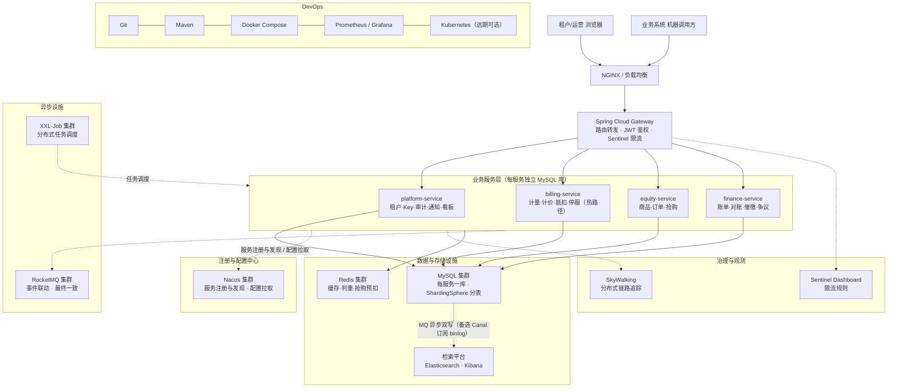
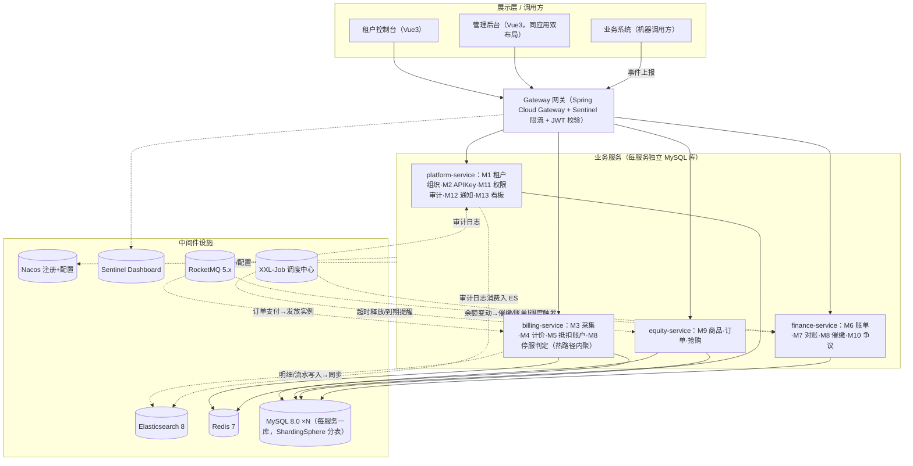
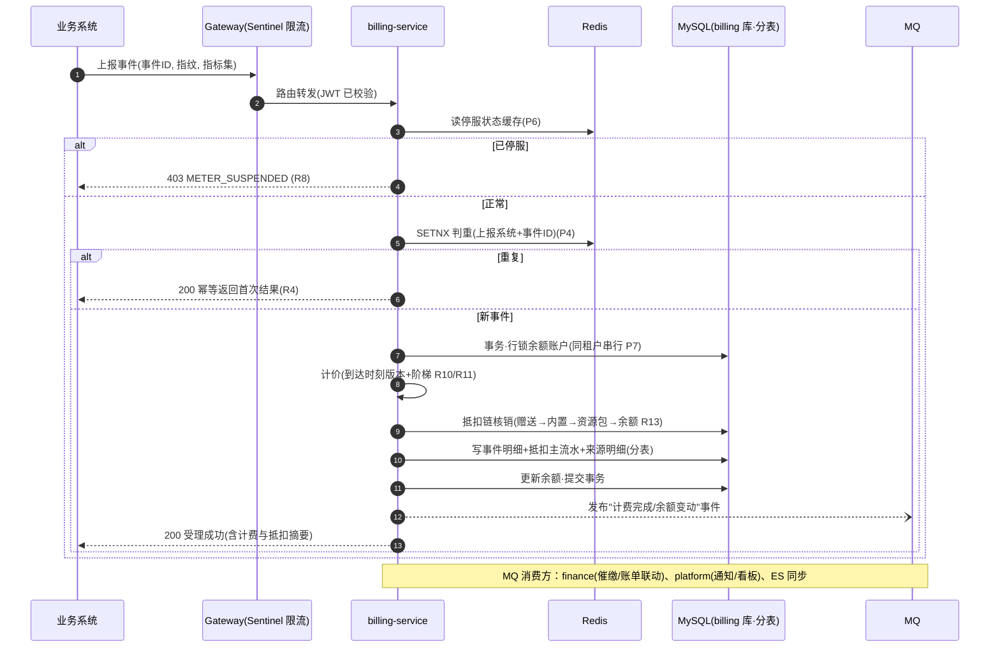
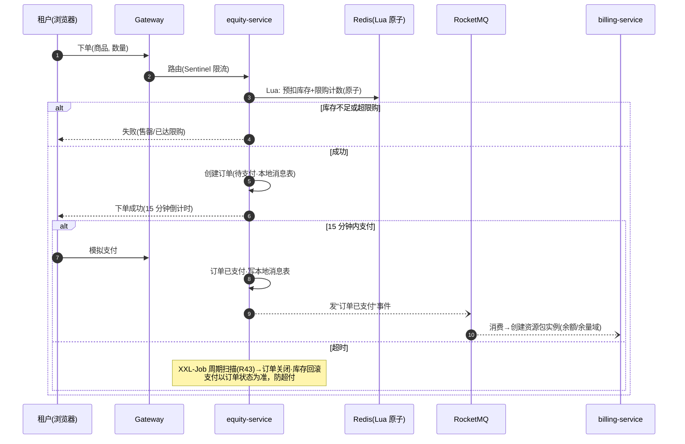

# MeterFlow 设计阶段 · 03 技术选型与整体架构

| | |
|---|---|
| 版本 | v2.0（已确认：DT-1~DT-6 裁决完毕；DT-6 由"模块化单体"改为"微服务全家桶"方向） |
| 日期 | 2026-11-03 |
| 阶段 | 设计阶段 · 第三阶段（技术选型与整体架构） |
| 依据 | requirements.md v1.1（R1–R44 + 非功能指标）；01.功能模块梳理.md v1.0（M1–M13）；02.总体架构与领域模型.md v1.0（架构原则 P1–P7、领域模型、协作口径） |
| 范围边界 | 确定整体技术方案与架构；**不展开**表结构、接口定义；**不编写**业务代码；prototype 原型不动 |

**标注约定**：【确认】= 已裁决口径；DT-xx = 裁决编号（5.3）；AD-xx = 技术决策；R-xx = 风险项。

---

## 1. 技术选型

### 1.1 选型总览【确认：DT-1~DT-6】

| 层面 | 选型 | 版本基线 | 一句话依据 |
|---|---|---|---|
| 后端语言/框架 | **Java 21 + Spring Boot 3.x**（虚拟线程开启） | Java 21 / Boot 3.3+ | 中台主流组合；虚拟线程支撑同步热路径 |
| 微服务框架 | **Spring Cloud Alibaba 2023.x**（Nacos 注册+配置、OpenFeign + LoadBalancer 服务间调用、Gateway 网关） | SCA 2023.0.x | DT-6 微服务方向的服务治理基座 |
| 服务拆分 | **网关 + 4 个业务服务**（platform / billing / equity / finance），拆分原则见 2.1 | — | 热路径内聚（P1）、抢购独立扩容、账务治理独立 |
| 流控/熔断 | **Sentinel 1.8**（网关限流 + 接口流控 + 熔断降级） | 1.8.x | ingest 与抢购接口的限流兜底，弱依赖熔断 |
| 消息中间件 | **RocketMQ 5.x**（事件联动、削峰、最终一致） | 5.x | DT-6 裁决引入；替代原"任务表+业务事件表"解耦方式（修订 AD-T3） |
| 数据库 | **MySQL 8.0**（每服务独立库，database per service） | 8.0.36+ | 事务与行级锁支撑同租户串行（P7） |
| 分库分表 | **ShardingSphere-JDBC 5.x**（明细/流水/审计按月分表） | 5.5+ | 亿级明细数据量（500 TPS 峰值折算年增十亿级）；分片键设计在 04 阶段定 |
| 检索 | **Elasticsearch 8.x**（消费明细检索、审计日志检索） | 8.x | 亿级数据的过滤检索与聚合；MySQL 权威账务，ES 承担查询面 |
| 缓存/原子操作 | **Redis 7.x** | 7.2+ | 判重 SETNX、抢购 Lua 原子预扣、停服状态缓存、热读缓存 |
| 任务调度 | **XXL-Job 2.4.x**（调度中心 + 各服务执行器） | 2.4+ | DT-4 裁决；失败重试/告警/可视化；业务幂等由任务表幂等键保证（R42） |
| 前端 | **Vue 3 + TypeScript + Vite + Element Plus**（单应用双端布局） | Vue 3.4+ | DT-2 裁决；与原型路由结构（#/t、#/a）一致 |
| 认证 | **JWT（无状态令牌）**，网关统一校验 | — | 两端统一登录，与原型"切换身份"演示模型吻合 |
| 链路观测 | **SkyWalking**（链路追踪 + 指标，开发阶段引入）【建议】 | 9.x | 微服务跨服务排障必需（R-7 对策） |
| 部署 | **Docker Compose 一键起全家桶**（网关+4 服务+Nacos+Sentinel+RocketMQ+ES+MySQL+Redis+XXL-Job） | — | 演示友好；注意本机资源占用（R-8） |

### 1.2 关键候选对比（关键项）

**应用形态（DT-6 裁决对比）**

| 候选 | 优势 | 劣势 | 结论 |
|---|---|---|---|
| 微服务全家桶（SCA + Nacos + Sentinel + RocketMQ + ShardingSphere + ES） | 展示分布式架构能力；各域独立扩缩容（抢购/计量）；中间件广度 | 开发/运维/联调成本高；本地资源占用大 | **已选（DT-6）** |
| 模块化单体 | 成本最低；热路径零跨服务跳数 | 无分布式叙事；扩容粒度粗 | 原推荐，被 DT-6 否 |
| 折中（单体+数据层中间件） | 复杂度可控 | 架构叙事不完整 | 未选 |

**消息中间件**：RocketMQ 5.x（已选）vs 不引入 MQ（原 AD-T3，被修订）vs Kafka——RocketMQ 与 SCA 生态契合、事务消息/延迟消息能力匹配业务（超时释放可改用延迟消息兜底）。

### 1.3 架构原则 P1–P7 的技术落点（微服务版，逐条回应）

| 原则 | 技术落点 |
|---|---|
| P1 热路径唯一且同步 | **热路径全部内聚在 billing-service**（M3 采集→M4 计价→M5 抵扣）：网关→billing 仅 1 跳，服务内无跨服务 RPC；其余能力全部旁路 |
| P2 事件只进不改 | 事件表 append-only（ShardingSphere 按月分表）；修正一律调整单追加 |
| P3 资金入口唯一 | 账户/额度/资源包余量的写路径**独占在 billing-service**；其他服务只能发 RocketMQ 事件，禁止直写（跨服务强约束） |
| P4 判重前置 | billing ingest 内 Redis SETNX 快拦 + 分表唯一索引兜底（I1） |
| P5 权限审计横切 | 各服务 AOP 记审计 → **RocketMQ → platform-service 消费入 ES**（审计检索）；两级审批岗位约束在 finance-service 服务层校验 |
| P6 停服入口生效 | 余额变动在 billing 内实时判定（阈值+状态机内聚），停服状态写 Redis；ingest 读缓存拒收（R8），毫秒级生效 |
| P7 同租户串行强一致 | billing 内余额账户行级锁串行抵扣；billing 独立库，无跨库事务 |

### 1.4 非功能指标回应

| 指标 | 方案回应 |
|---|---|
| 事件峰值 500 TPS、受理 P99<1s | 网关（1 跳）→ billing 同步链；Redis 判重 + 单行事务 + 虚拟线程；Sentinel 对 ingest 限流兜底 |
| 抢购峰值 1,000 QPS | **equity-service 独立部署独立扩容**；Redis Lua 原子预扣+限购计数；Sentinel 网关限流；支付成功经 RocketMQ 通知 billing 发放实例（最终一致） |
| 明细亿级（峰值折算年增十亿级） | ShardingSphere-JDBC 按月分表（明细/抵扣流水/审计日志）；查询面走 ES 8 |
| 计量链路可用性 99.9% | 热路径依赖 = Gateway + billing + MySQL + Redis；Nacos/Sentinel/ES/RocketMQ/XXL-Job 均为旁路（故障降级策略见 5.2） |
| 数据保留 | 明细/流水/审计分表归档 ≥ 保留期（1 年/1 年/账单≥3 年），归档策略 04 阶段定 |

### 1.5 技术栈一览（版本基线，对照 NFTurbo 逐项校准）

> 参照 NFTurbo 技术栈清单格式；"进展"列 = 采用 / 备选 / 不采用。三处刻意差异：Dubbo→OpenFeign（热路径内聚无高性能 RPC 诉求）、Seata→本地消息表+对账兜底（R-8）、无 OSS/uniapp（无文件与小程序需求）；并修正 NFTurbo 的版本错配（Boot 3.2 应配 SCA 2023.0.x）。

**后端技术**

| 采用技术 | 版本 | 进展 | 说明 |
|---|---|---|---|
| Java | 21（LTS，虚拟线程） | 采用 | |
| Spring / Spring MVC | 6.1.x | 采用 | |
| Spring Boot | 3.2.x（3.2.5+） | 采用 | 须配 Spring Cloud 2023.0.x + SCA 2023.0.1.0 |
| Spring Cloud | 2023.0.x | 采用 | |
| Spring Cloud Alibaba | 2023.0.1.0 | 采用 | |
| Spring Cloud Gateway / LoadBalancer | 4.1.x | 采用 | 网关路由 / 客户端负载均衡 |
| Nacos（注册+配置中心） | 2.3.x（server） | 采用 | |
| Sentinel（限流熔断） | 1.8.6 + Dashboard | 采用 | ingest 与抢购接口限流兜底 |
| RPC | OpenFeign 4.1.x | 采用 | 热路径内聚 billing，无高性能 RPC 诉求；Dubbo 3.2 为备选 |
| 认证鉴权 | Sa-Token 1.38（JWT 无状态模式） | 采用 | 细化 AD-T6：登录/权限点/注解鉴权开箱即用 |
| 缓存 | JetCache 2.7（两级）+ Caffeine 3.1 | 采用 | 停服状态/Key 校验热读；本地+远程统一抽象 |
| 分布式锁 | Redisson 3.27 | 采用 | 任务防重/抢购辅助锁 |
| Redis（服务端） | 7.2 | 采用 | 判重 SETNX、抢购 Lua 预扣、停服状态 |
| 任务调度 | XXL-Job 2.4.1 | 采用 | DT-4 |
| 消息队列 | RocketMQ 5.1+ | 采用 | 事件联动、最终一致（本地消息表） |
| 分库分表 | ShardingSphere-JDBC 5.5.0 | 采用 | 明细/流水/审计按月分表；分片键 04 阶段定 |
| 连接池 | Druid 1.2.20 | 采用 | 与 ShardingSphere 兼容性好 + 监控面板 |
| 数据库 | MySQL 8.0.36 | 采用 | 每服务独立库 |
| ORM | MyBatis-Plus 3.5.7（+原生 XML） | 采用 | 多租户/乐观锁插件；复杂计费 SQL 走 XML |
| 检索 | Elasticsearch 8.13.x + Kibana 8.13.x | 采用 | 明细/审计查询面 |
| binlog 同步 | Canal 1.1.7 | 备选 | 默认 MQ 异步双写入 ES；04 阶段评估 |
| JSON | Jackson 2.17（Spring 默认） | 采用 | 资金数据求稳，不用 Fastjson2 |
| 工具库 | Hutool 5.8.27 / Lombok 1.18.32 / MapStruct 1.5.5 | 采用 | |
| 日志 | Logback 1.5.x | 采用 | 审计走 MQ→ES，不引 Logstash |
| 链路观测 | SkyWalking 9.7 + Prometheus/Grafana | 采用 | R-7 对策 |
| 接口文档 | springdoc-openapi 2.5 | 采用 | 随代码生成 |
| Seata | — | 不采用 | 本地消息表 + RocketMQ + M7 对账兜底（R-8） |
| 阿里云 OSS | — | 不采用 | 无文件存储需求 |
| dynatic-tp | — | 不采用 | 虚拟线程 + XXL-Job 已覆盖 |

**前端技术**

| 采用技术 | 版本 | 进展 | 说明 |
|---|---|---|---|
| Vue / TypeScript | 3.4 / 5.x | 采用 | 单应用双端布局（#/t、#/a） |
| Vite | 5.x | 采用 | |
| Element Plus | 2.7 | 采用 | 双端后台组件库 |
| Pinia / Vue Router / Axios | 2.x / 4.x / 1.7 | 采用 | |
| ECharts | 5.5 | 采用 | 数据看板 |
| uniapp | — | 不采用 | 无小程序需求 |

**开发工具**：IDEA、Git、Maven 3.9、Docker Desktop、Apifox、Navicat/DBeaver、Chrome、Kibana。

---

## 2. 整体架构设计

### 2.1 项目工程架构图（分层视图）

> 样式对齐参考项目（NFTurbo）：接入终端 → 接口层 → 业务服务层 → 基础服务层 → 通用组件层，右侧为统一认证与日志记录。**基础服务层为各服务内的领域模块（包级组件），不是独立进程**——对外进程只有 2.2 中的 4 个服务。

```mermaid
flowchart LR
    subgraph SG1["接入终端"]
        direction LR
        A1["租户控制台 Web"]
        A2["管理后台 Web"]
        A3["业务系统 上报方"]
    end
    subgraph SG2["接口层"]
        direction LR
        B1["gateway 路由·鉴权·限流"]
        B2["loadbalancer"]
    end
    subgraph SG3["业务服务层"]
        direction LR
        C1["platform-service"]
        C2["billing-service 热路径"]
        C3["equity-service 抢购"]
        C4["finance-service"]
    end
    subgraph SG4["基础服务层（服务内领域模块）"]
        direction LR
        D1["metering"] ~~~ D2["pricing"] ~~~ D3["deduction"] ~~~ D4["account"] ~~~ D5["suspension"] ~~~ D6["goods"] ~~~ D7["order"] ~~~ D8["flash-sale"]
        D9["bill"] ~~~ D10["recon"] ~~~ D11["dispute"] ~~~ D12["urge"] ~~~ D13["tenant"] ~~~ D14["apikey"] ~~~ D15["audit"] ~~~ D16["notify"]
    end
    subgraph SG5["通用组件层 common"]
        direction LR
        E1["cache"] ~~~ E2["config"] ~~~ E3["datasource"] ~~~ E4["lock"] ~~~ E5["es"] ~~~ E6["web"]
        E7["mq"] ~~~ E8["rpc"] ~~~ E9["job"] ~~~ E10["limiter"] ~~~ E11["idempotent"] ~~~ E12["audit"]
    end
    AUTH["统一认证 JWT·网关校验"]
    LOG["日志记录 审计+链路"]
    SG1 --> SG2
    SG2 --> SG3
    SG3 --> SG4
    SG4 --> SG5
    AUTH -.-> SG2
    LOG -.-> SG3
    classDef term fill:#dbeafe,stroke:#3b82f6,color:#1e3a8a
    classDef api fill:#fde68a,stroke:#d97706,color:#78350f
    classDef svc fill:#fecdd3,stroke:#e11d48,color:#881337
    classDef base fill:#bbf7d0,stroke:#16a34a,color:#14532d
    classDef common fill:#a5f3fc,stroke:#0891b2,color:#164e63
    classDef side fill:#fca5a5,stroke:#dc2626,color:#7f1d1d
    class A1,A2,A3 term
    class B1,B2 api
    class C1,C2,C3,C4 svc
    class D1,D2,D3,D4,D5,D6,D7,D8,D9,D10,D11,D12,D13,D14,D15,D16 base
    class E1,E2,E3,E4,E5,E6,E7,E8,E9,E10,E11,E12 common
    class AUTH,LOG side
    style SG1 fill:#eff6ff,stroke:#93c5fd
    style SG2 fill:#fffbeb,stroke:#fcd34d
    style SG3 fill:#fff1f2,stroke:#fda4af
    style SG4 fill:#f0fdf4,stroke:#86efac
    style SG5 fill:#ecfeff,stroke:#67e8f9
```



### 2.2 技术架构拓扑图（部署视图）

> 与参考图对齐：左侧调用链（终端 → NGINX/LB → Gateway → 服务），上方注册配置中心，下方/右侧中间件集群，底部 DevOps。差异点已在图下说明。



> 与参考实现（NFTurbo）的三处 deliberate 差异：① **不用 Seata**——跨服务一致性（订单支付→实例发放、余额联动）采用"本地消息表 + RocketMQ + 幂等消费"，由 M7 对账域兜底（R-8）；② **MySQL→ES 同步默认走 MQ 异步双写**，Canal 订阅 binlog 为备选方案（评估在 04 阶段）；③ 观测以 SkyWalking 为准，Spring Boot Admin 为可选补充。

### 2.3 服务与中间件关系图



### 2.4 服务拆分原则（DT-6 的拆分依据）

| # | 原则 | 说明 |
|---|---|---|
| S1 | **热路径内聚**：抵扣链所需数据（事件/计价/额度/资源包余量/余额）全部在 billing-service 单库内 | 保障 P1/P7：热路径零跨服务 RPC |
| S2 | **扩容独立性**：equity-service（抢购 1,000 QPS）与 billing（500 TPS）互不影响 | 独立部署、独立 Redis 逻辑分区 |
| S3 | **账务治理独立**：finance-service 聚合 M6/M7/M10（对账、冲正、争议天然同域） | 与热路径隔离，任务重跑不冲击交易 |
| S4 | **资源包余量归 billing、商品订单归 equity**：支付成功经 RocketMQ"订单已支付"事件 → billing 创建实例（本地消息表保证最终一致） | 解决跨服务余量强一致问题（I3） |
| S5 | **跨服务只经事件/只读接口**：资金与余量禁止跨服务直写（P3 强化） | 最终一致由 M7 对账体系兜底 |

### 2.5 计量计费热路径时序



### 2.6 抢购链路时序（equity 独立扩容，回应 1,000 QPS）



### 2.7 数据流与任务流

- **同步**：展示层 → Gateway → 各服务（领域对象+不变量校验）→ 本服务 MySQL；
- **异步事件流**（RocketMQ）：计费完成/余额变动（billing→finance/platform）、订单已支付（equity→billing）、审计日志（各服务→platform→ES）、争议/审核结果（finance→platform 通知）；
- **任务流**（XXL-Job）：日切+出账+对账（finance）、支付超时释放+到期提醒（equity）、审计归档（platform）；失败重试与告警由 XXL-Job 承担，业务幂等由任务表幂等键保证（R42）；
- **查询面**：消费明细/审计检索走 ES（02 D2 的两级流水结构同步到 ES 文档）；控制台精确过滤可回落 MySQL 分表。

---

## 3. 模块架构设计（M1–M13 → 服务映射）

| 模块 | 归属服务 | 关键设施 | 协作口径 |
|---|---|---|---|
| M1 租户与组织 | platform-service | MySQL(platform 库) | 同步；向各服务提供租户/部门只读缓存 |
| M2 API Key | platform-service | MySQL + Redis（Key 状态缓存） | 同步；billing/equity 经缓存校验 |
| M3 计量采集 | **billing-service**（ingest 入口） | Redis（停服+判重）+ MySQL（分表） | 同步热路径 |
| M4 计价引擎 | **billing-service** | MySQL（版本/游标） | 同步（服务内调用） |
| M5 抵扣与账户 | **billing-service** | MySQL（行锁）+ Redis（余额缓存读） | 同步（串行 P7） |
| M6 账单账期 | finance-service | MySQL(finance 库) + XXL-Job | 异步任务 + 同步查询 |
| M7 对账差错 | finance-service | MySQL + ES（数据源）+ XXL-Job | 异步任务 + 同步审批 |
| M8 欠费停服 | 判定/恢复 → **billing-service**（账户域内聚，实时）；催缴/欠费清单 → finance-service | Redis（停服状态）+ MQ 事件 | 判定同步；催缴异步 |
| M9 资源包权益 | 商品/订单/抢购 → **equity-service**；实例台账 → **billing-service**（抵扣链强一致，S4） | Redis（Lua）+ MySQL + MQ | 下单同步；实例经事件最终一致 |
| M10 争议工单 | finance-service | MySQL | 同步（补偿走 M7 审批） |
| M11 权限审计 | platform-service（审计经 MQ 汇聚入 ES） | AOP + RocketMQ + ES | 横切 |
| M12 通知消息 | platform-service（消费各域事件） | MySQL + RocketMQ | 事件联动 |
| M13 数据看板 | platform-service | ES 聚合 + MySQL 只读 | 只读 |

> 跨服务一致性说明：订单支付→实例发放、余额变动→催缴/账单，均为**最终一致**（本地消息表 + RocketMQ + 幂等消费），由 M7 对账体系兜底校平——这与"对账差错"业务域的存在自洽。

---

## 4. 项目目录设计（对齐 NFTurbo 工程风格：DDD 分层 + 标准化包约定）【确认】

### 4.1 根目录（Maven 多模块聚合工程）

```
MeterFlow ~/MeterFlow
├── .idea / .gitignore
├── meterflow-gateway/     # 网关服务（独立部署）
├── meterflow-platform/    # 平台支撑服务（独立部署）
├── meterflow-billing/     # 计费核心服务（独立部署·热路径）
├── meterflow-equity/      # 权益服务（独立部署·抢购独立扩容）
├── meterflow-finance/     # 财务治理服务（独立部署）
├── meterflow-common/      # 通用组件模块（被所有服务依赖）
├── docs/                  # 设计文档（01/02/03 既有）
├── prototype/             # 交互原型（既有·只读参考）
├── web/                   # 前端（Vue3 单应用双端）
├── deploy/                # docker-compose 全家桶
├── requirements.md / meterflow.md
└── pom.xml                # 父 POM（依赖版本管理）
```

### 4.2 业务服务标准结构（DDD 分层，以最复杂的 billing 为例）

```
meterflow-billing
├─ src
│  ├─ main
│  │  ├─ java/com/meterflow/billing
│  │  │  ├─ controller                    # Controller 层（HTTP 接口）
│  │  │  │  ├─ ingest/IngestController    #   事件上报入口（业务系统调用）
│  │  │  │  ├─ console/                   #   租户端：用量/明细/账单查询
│  │  │  │  └─ adminapi/                  #   平台端：计价/账户/实例管理
│  │  │  ├─ facade/api                    # facade 层（供其他服务 OpenFeign 调用的内部接口）
│  │  │  │                                #   如：停服状态/余额/实例台账只读查询
│  │  │  ├─ application/service           # 应用层（用例编排·事务边界）
│  │  │  │                                #   EventAcceptAppService / RechargeAppService ...
│  │  │  ├─ domain                        # 领域层（聚合与领域服务·不变量落点）
│  │  │  │  ├─ metering/                  #   事件/双保险判重/日切
│  │  │  │  ├─ pricing/                   #   阶梯计价/价格版本
│  │  │  │  ├─ deduction/                 #   抵扣链编排
│  │  │  │  ├─ account/                   #   余额账户/透支/充值
│  │  │  │  └─ package/                   #   资源包实例台账
│  │  │  ├─ infrastructure                # 基础设施层
│  │  │  │  ├─ cache/                     #   Redis：判重 SETNX/停服状态/余额缓存
│  │  │  │  ├─ channel/                   #   RocketMQ 生产者/消费者 + 本地消息表
│  │  │  │  └─ shard/                     #   ShardingSphere 分表配置
│  │  │  ├─ job                           # 定时任务层（XXL-Job 执行器：日切辅助/归档）
│  │  │  ├─ mapper                        # mapper 层（MyBatis-Plus Mapper 接口）
│  │  │  ├─ param                         # 入参（IngestParam / PageQuery ...）
│  │  │  ├─ vo                            # 出参（BillVO / DeductionChainVO ...）
│  │  │  ├─ exception                     # 异常定义（BillingErrorCode / BillingException）
│  │  │  └─ BillingApplication            # 启动类
│  │  └─ resources
│  │     ├─ mapper/                       # Mapper XML（复杂计费 SQL）
│  │     ├─ application.yml               # 配置文件
│  │     ├─ bootstrap.yml                 # Nacos 配置中心引导
│  │     └─ logback-spring.xml            # 日志配置文件
│  └─ test/java/com/meterflow/billing     # 单元测试（含 application-test.yml 单测配置）
└─ pom.xml
```

> 分层规范对齐 NFTurbo（controller / application.service 应用层 / domain 领域层 / facade facade 层 / infrastructure.channel 基础设施层 / job 定时任务层 / mapper）。其余三个服务（platform / equity / finance）采用同一模板，差异包：equity 增 `flashsale/`（Lua 原子预扣组件）；finance 增 `approval/`（两级审批域）；platform 增 `auth/`（Sa-Token 全局配置）、`audit/`、`notify/`、`dashboard/`。

### 4.3 网关模块 meterflow-gateway（对齐 NFTurbo gateway 风格）

```
com.meterflow.gateway
├─ auth/                     # 认证相关的配置：AuthFilter / SaTokenConfigure / StpInterfaceImpl
├─ ratelimit/                # Sentinel 限流规则（ingest / 抢购接口）
└─ GatewayApplication        # 启动类
resources：application.yml / bootstrap.yml / logback-spring.xml
```

### 4.4 通用组件模块 meterflow-common

```
com.meterflow.common
├─ api/          # 统一响应 Results / 分页封装
├─ event/        # 业务事件定义（MQ 主题与 payload 契约，04 阶段产出）
├─ audit/        # 审计注解 @AuditLog + 切面（P5 横切）
├─ idempotent/   # 判重/幂等组件（SETNX 前置 + 唯一索引兜底）
├─ lock/         # Redisson 分布式锁封装
├─ web/          # 全局异常处理 / 登录态上下文透传
└─ utils/        # 精度工具（逐笔 4 位小数）/ Hutool 扩展
```

### 4.5 与 NFTurbo 模式的差异声明

1. **未采用**其"business 聚合 + 统一启动类（可分可合）"模式：MeterFlow 四服务独立部署，各自持有启动类（NFTurbo 的 nft-turbo-app 模式服务于其"可单体可拆分"的诉求）；
2. **采用**其 DDD 分层规范与 param/vo/exception 标准包约定；
3. facade 层实现方式从 Dubbo RPC 改为 OpenFeign 内部接口。

### 4.6 前端与部署（既有不变）

```
web/src/{api, router, stores, views/tenant, views/admin, components}   # 前端不感知服务拆分（Gateway 统一入口）
deploy/{docker-compose.yml, init/}                                     # 全家桶与各库初始化脚本
```

> 前端不需要感知服务拆分：Gateway 统一入口 + 按域前缀路由（`/t/**`、`/a/**` 原样保留）。

---

## 5. 关键设计决策、风险与裁决

### 5.1 技术决策记录

| # | 决策 | 备选与取舍 |
|---|---|---|
| AD-T1 | ~~模块化单体~~ → **微服务（网关+4 服务）**（DT-6 修订）：热路径内聚 billing，扩容域独立 | 单体：成本低但无分布式叙事；更细拆分：热路径跨服务 RPC，破坏 P1/P7，已否 |
| AD-T2 | Java 21 虚拟线程承载同步热路径 | 传统线程池需调优；Reactive 账务表达复杂 |
| AD-T3 | ~~不引入 MQ~~ → **引入 RocketMQ 5.x**（DT-6 修订）：事件联动、订单支付→实例发放、审计汇聚；本地消息表保证最终一致 | 任务表轮询：实现轻但联动面广后不可维护；Kafka：与 SCA 生态契合度低 |
| AD-T4 | Redis Lua 原子预扣抢购库存，DB 兜底对账 | 纯 DB 行锁：热点行竞争；纯 Redis：丢锁风险 → 双层 |
| AD-T5 | 判重 = Redis SETNX 前置 + 分表唯一索引兜底 | 单一手段各有故障窗口 → 双保险对齐 I1 |
| AD-T6 | JWT 无状态认证，网关统一校验 | Session 需粘滞；与原型"切换身份"演示吻合 |
| AD-T7 | Vue 单应用双端布局 | 双 SPA 重复构建配置 |
| AD-T8 | 引入 XXL-Job 统一调度（DT-4）；业务幂等由任务表/幂等键保证 | 应用内调度失败处理需自建 |
| AD-T9 | **ShardingSphere-JDBC 按月分表**：明细/抵扣流水/审计日志；分片键=租户+时间（04 阶段定） | MySQL 原生分区：跨年扩展与扩容弱；不分表：亿级单表风险 |
| AD-T10 | **ES 8 承担明细/审计查询面**，MySQL 保留权威账务 | 纯 MySQL 分表：亿级模糊检索代价高；ES 双写经 MQ 异步，允许秒级延迟 |
| AD-T11 | 服务拆分遵循 S1–S5（热路径内聚/扩容独立/账务独立/余量归 billing/跨服务只走事件） | 按模块一一对应拆 13 个服务：过碎，热路径被切碎 |

### 5.2 潜在风险与对策

| # | 风险 | 对策 |
|---|---|---|
| R-1 | 单机演示环境与 500 TPS/1,000 QPS 指标的验证差距 | 压测脚本验证关键路径；文档以"设计承载力"表述 |
| R-2 | Redis 故障窗口 | 判重降级 DB 唯一索引兜底；抢购暂停开售（业务可接受） |
| R-3 | 同租户锁等待（极端大租户） | 单事务收窄（只锁账户行）；500 TPS 量级无可感知影响 |
| R-4 | 模拟支付与真实电商语义边界 | 订单状态机与超时释放完整（R32/R43），支付通道接口位预留 |
| R-5 | 跨服务边界随迭代被破坏 | S1–S5 拆分原则 + 代码评审 checklist + ArchUnit（开发阶段引入） |
| R-6 | XXL-Job Admin 可用性 | 故障仅暂停任务面，恢复后按幂等键补跑 |
| R-7 | 微服务跨服务排障困难 | 引入 SkyWalking 链路追踪【建议】+ 统一 traceId 贯穿日志 |
| R-8 | **分布式事务一致性**（订单支付→实例发放、余额变动→账单联动） | 本地消息表 + RocketMQ + 幂等消费；最终一致由 M7 对账兜底——对账域天然兜底是本架构的自洽点 |
| R-9 | **本地资源占用**：全家桶 compose 内存估算 10GB+ | docker-compose 提供精简 profile（按需启停 ES/RocketMQ）；文档给出最低配置要求 |
| R-10 | ES 与 MySQL 双写不一致 | 经 MQ 异步同步 + 对账任务校平；ES 只承担查询面，不承载账务 |

### 5.3 裁决结果（交互确认）

| 编号 | 结论 |
|---|---|
| DT-1 | 后端 = Java 21 + Spring Boot 3（虚拟线程）【确认】 |
| DT-2 | 前端 = Vue 3 + TypeScript + Element Plus（单应用双端）【确认】 |
| DT-3 | 部署 = Docker Compose 全家桶（含 Nacos/Sentinel/RocketMQ/ES/XXL-Job）【确认】 |
| DT-4 | 调度 = XXL-Job【确认】 |
| DT-5 | 02 阶段 D1–D3 按建议确认【确认】→ 02 v1.0 |
| **DT-6** | **应用形态 = 微服务全家桶**（网关 + platform/billing/equity/finance 4 服务；引入 Spring Cloud Alibaba、Nacos、Sentinel、RocketMQ、ShardingSphere、ES 8），修订 AD-T1/AD-T3【确认，2026-11-03】 |

---

## 6. 下一步

1. 本档 v2.0 为现行技术方案基线；
2. 下一步进入 **04 阶段：数据模型设计**——按"每服务一库"产出各库表结构、ShardingSphere 分片键与分表策略、ES 索引设计、MQ 主题与事件契约，待你指令后开始。

### 变更记录

| 版本 | 日期 | 说明 |
|---|---|---|
| v0.1 | 2026-11-03 | 技术选型与整体架构初稿（模块化单体方向），核心选型待确认 |
| v1.0 | 2026-11-03 | 裁决 DT-1~DT-5：Java 21+Boot3 / Vue3 / Docker Compose / XXL-Job / D1–D3 |
| v1.1 | 2026-11-03 | 新增附录 A「Agent 扩展性评估」（前瞻性规划） |
| v2.0 | 2026-11-03 | **DT-6 裁决：转向微服务全家桶**——重构选型总览、服务拓扑与拆分原则（S1–S5）、热路径/抢购时序、模块映射、目录结构、决策 AD-T1/T3 修订、新增 AD-T9~T11 与 R-7~R-10 |
| v2.1 | 2026-11-03 | 参照 NFTurbo 风格新增 2.1 项目工程架构图（分层）与 2.2 技术架构拓扑图（部署），原拓扑图调整编号为 2.3 |
| v2.2 | 2026-11-03 | 新增 §1.5 技术栈一览（版本基线，对照 NFTurbo 逐项校准）：补齐 ORM/缓存/连接池/认证/工具链细节层，标注 Dubbo/Seata/OSS/uniapp 等不采用项及理由，修正 SCA 版本搭配 |
| v2.3 | 2026-11-03 | §4 目录设计对齐 NFTurbo 工程风格：根聚合工程 + DDD 分层标准结构（controller/facade/application/domain/infrastructure/job/mapper + param/vo/exception）+ 网关与 common 模块细化，并声明与 NFTurbo 的差异（不采用 business 聚合统一启动模式） |

---

## 附录 A · Agent 扩展性评估（前瞻性规划，不属于本期范围）

> 记录"未来在 MeterFlow 上增加 AI Agent 能力"的可行性结论与预留点，**不构成需求变更、不进入本期开发**。

**结论**：微服务架构对 Agent 反而更自然——推荐新增独立的 `agent-service`（Java 栈 + Spring AI，经 Nacos 注册、OpenFeign 调用各域只读接口），工具（Function Calling）映射为各服务内部 API；资金操作 Agent 只能"发起"，仍走 finance 调整单两级审批（R41 约束 AI 资金权限）。仅当出现重度多 Agent 编排/复杂 RAG 时，再评估 Python 旁路服务。

**契合点**：抵扣流水两级结构（D2）支撑"费用解释"类工具；M11 审计经 MQ 汇聚，Agent 动作同样入审计；RocketMQ 承载 Agent 触发的业务事件；XXL-Job 承载定时型 Agent 任务；Agent 自身 token 用量未来可接入自身计量计费。

**预留点（04 阶段顺手落实）**：`meterflow-agent/` 服务占位；审计动作类型枚举可扩展；LLM 网关位（模型/密钥/超时配置化）。
